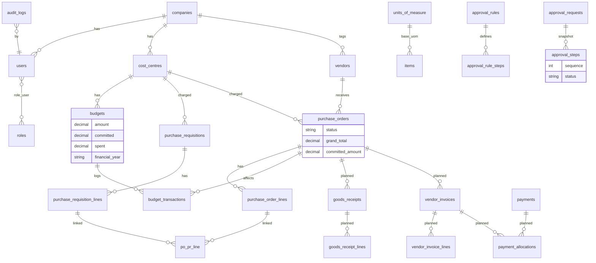

# Procure-to-Pay (P2P) Module – Acme Industries

A multi-company purchasing back-office: Purchase Requisition → Approval → Purchase Order → Budget commitment (goods receipt, invoice matching and payment are designed in the schema but not built yet – see "What is not finished").

**Stack:** PHP 8.2, Laravel 11, MySQL/MariaDB, Blade (server-rendered views), PHPUnit.

---

## 1. Why Laravel 11

Eloquent, migrations, seeders, events/listeners, policies/gates, form requests, queues and the testing tools are built in. This let me spend the time on the business rules (approvals, budget, GST) instead of plumbing. CodeIgniter 4 would have meant writing more of this by hand.

---

## 2. Setup

### Option A – XAMPP / local PHP (what I developed on)

```bash
composer install
cp .env.example .env
php artisan key:generate
# create an empty database (example name: p2p) and set DB_* values in .env
php artisan migrate:fresh --seed
php artisan serve
```

Open http://127.0.0.1:8000

### Option B – Docker

A `Dockerfile` / `docker-compose.yml` (app, nginx, mysql, queue worker) are included.

```bash
docker compose up -d --build
docker compose exec app composer install
docker compose exec app php artisan key:generate
docker compose exec app php artisan migrate:fresh --seed
```

### Run the tests

```bash
php artisan test
```

---

## 3. Demo logins (password for all: `password`)

| Email | Company | Roles |
|---|---|---|
| admin.mum@acme.test | ACME-MUM | Admin |
| req.mum@acme.test | ACME-MUM | Requester |
| depthead.mum@acme.test | ACME-MUM | Dept Head, Requester |
| ithead.mum@acme.test | ACME-MUM | IT Head |
| finhead.mum@acme.test | ACME-MUM | Finance Head |
| cfo.mum@acme.test | ACME-MUM | CFO |
| proc.mum@acme.test | ACME-MUM | Procurement Officer |
| store.mum@acme.test | ACME-MUM | Store Keeper |
| accounts.mum@acme.test | ACME-MUM | Accounts |
| admin.blr@acme.test | ACME-BLR | Admin |
| req.blr@acme.test | ACME-BLR | Requester |
| depthead.blr@acme.test | ACME-BLR | Dept Head |
| proc.blr@acme.test | ACME-BLR | Procurement Officer |

Seed data follows Appendix A: 2 companies, 13 users, units of measure, cost centres and FY 2026-27 budgets, 4 vendors, 6 items and approval rules 1–6.

---

## 4. What is built

| Module | Status |
|---|---|
| M1 Masters (vendors, items, UoM with conversion, cost centres) | Done (seeded, company scoped) |
| M2 Budget control (commit / release, row locking) | Done |
| M3 Approval workflow (DB rules, sequential, snapshot, "Pending my approval") | Done |
| M4 PR → PO (merge, split, qty limit, GST per line, PO approval) | Done |
| Audit trail (append-only) | Done |
| Company isolation, roles, policies | Done |
| M5 Goods receipt (GRN) | Not built (tables exist) |
| M6 Vendor invoice and 3-way match | Not built (tables exist) |
| M7 Payments, TDS, ledger, ageing | Not built |
| M8 Reports | Partly (budget screen only) |
| M9 Stretch (escalation, notifications, SSO, CI) | Not built |

---

## 5. Architecture

- **Controllers** only validate (Form Requests), authorise (Policies/Gates) and delegate.
- **Business logic** lives in service/action classes, for example `ApprovalChainBuilder`, `ApprovalService`, `GstCalculator`, `UomConverter`, `BudgetService`, `FinancialYear`, `AuditLogger`.
- **Events/listeners:** `PurchaseOrderApproved` triggers the budget commitment. The listener is **synchronous on purpose**: a queued listener would run after the transaction finished, so a budget failure could no longer roll back the approval.
- **Status enums** with an allowed-transition map block invalid jumps (e.g. DRAFT → RECEIVED).
- **Authorisation is enforced server-side** (middleware, gates, policies), not only by hiding buttons.

### ER diagram



Relations marked "planned" exist as tables but have no application logic yet.

---

## 6. Design decisions and assumptions

### Approval rules – how Rule 4 (extra step) combines with Rules 1–3
- Rules live in the database (`approval_rules`, `approval_rule_steps`), so an Admin can change them without a deployment.
- **BASE rules** (1–3, 5–6) are chosen by document type and amount range. Exactly one BASE rule must match.
- **EXTENSION rules** (4) match by item category and insert their role **after a named role** of the base chain.
- Example (S2): 195,000 IT requisition → base chain `Dept Head → Finance Head`, extension adds `IT Head` after `Dept Head` → **Dept Head → IT Head → Finance Head**.
- If a PR has lines of several categories, every matching extension is applied once.
- If no BASE rule matches, submission fails with a clear error.

### Snapshot
On submit the final chain is copied into `approval_requests` / `approval_steps`. After that the document only uses its own steps, so later rule changes never affect it.

### Sequential approval, rejection, self-approval
- Only the lowest pending step can be acted on.
- Any rejection ends the workflow; a comment is mandatory; the document goes back to the requester with the comment (PR → REJECTED, PO → DRAFT).
- **Self-approval (S8):** a user can never approve a document they created. When the snapshot is built, steps whose role the creator holds are removed. If that leaves no step, `Finance Head` is used as the fallback approver. The check is repeated at approve time.

### Budget control and concurrency
- Financial year is April–March, taken from the PO date.
- On the **last** PO approval step, inside one DB transaction: lock the budget row (`lockForUpdate`), check `available = budget − committed − spent`, add to `committed`, then set the PO to APPROVED. If the budget is not enough the whole transaction rolls back (PO stays PENDING_APPROVAL) and the approver sees a clear message.
- Because the row is locked, two POs approved at the same moment are serialised: the second one sees the updated committed amount and fails if there is not enough budget (S3).
- Cancelling an approved PO releases its committed amount in the same transaction.
- Every budget change is written to the append-only `budget_transactions` table.

### GST
- Same state as the buying company → CGST + SGST (half of the rate each); different state → IGST (full rate).
- Calculated **per line**, each component rounded to 2 decimals **half-up** using integer/bcmath arithmetic. No floats are used for money.
- Example: taxable 12,250.00 at 12% intra-state → CGST 735.00 + SGST 735.00 → total 13,720.00.

### Units of measure
- Quantities are stored as entered (qty + unit) **and** as base quantity using the conversion factor (1 BOX = 12 PCS).
- Unit price is the price per the **unit entered** (e.g. per BOX). Taxable value = entered qty × entered unit price. Base quantity is used only to compare quantities across units.

### Company isolation
- Every company-owned table has `company_id`; a `BelongsToCompany` global scope filters queries by the logged-in user's company and sets it on create.
- Policies also check the company. Opening another company's record by URL returns 404/403.
- The scope is safe when there is no logged-in user (seeders, console, queue).

### Audit trail
- `audit_logs` stores who, when, from-status, to-status and comment for status changes. The model throws an exception on update or delete, so the application can only append.

### Other assumptions
- A PO merges PR lines of the **same vendor, same company and same cost centre**.
- Vendors are tagged to the company that created them; only active vendors of the user's company can be used.
- PO and PR numbers are generated inside the transaction (`PO-YYYYMMDD-0001`).
- Roles are many-to-many; a user can hold several roles.

### Composer packages
No extra packages beyond the Laravel 11 defaults. *(Update this line if you added any, and say why.)*

---

## 7. What is not finished and how I would do it

| Item | Approach |
|---|---|
| **GRN (M5)** | Store Keeper creates a GRN against an approved PO. Convert entered qty to base units with `UomConverter`. In one transaction, lock the PO lines and check that total accepted base qty ≤ ordered base qty × (1 + tolerance). Tolerance (5%) in `config/p2p.php`. Update PO to PARTIALLY_RECEIVED / RECEIVED automatically. |
| **Invoice and 3-way match (M6)** | Unique index on (vendor_id, invoice_number). Per line: billed qty ≤ accepted − already invoiced; price within ±2% compared per base unit; GST type and rate equal to the expected values. All pass → MATCHED, else ON_HOLD with a reason per line. Override needs a mandatory comment written to the audit log. Posting fires `InvoicePosted`; a synchronous listener moves the amount from committed to spent. |
| **Payments, TDS, ledger, ageing (M7)** | Payment allocations against posted invoices (partial allowed). TDS 2% on the taxable value of SERVICES lines. Ledger with a running balance; ageing buckets from due date = invoice date + vendor payment terms. |
| **Reports (M8)** | Budget vs committed vs spent, open POs with pending quantity, invoices on hold. |
| **Escalation (M9a)** | Scheduled command in `routes/console.php` that finds approval steps pending for more than 48 hours and notifies the approver and manager. |
| **Notifications (M9b)** | Laravel queued notifications on submit, approve, reject and hold. |
| **SSO (M9c)** | Socialite with an OpenID Connect provider such as Keycloak; map token roles to the `roles` table. |
| **CI (M9d)** | GitHub Actions workflow running `composer install` and `php artisan test` on every push. |
| **Tests** | Add feature tests for GRN tolerance, 3-way match (one pass, two holds), payments and a parallel-process test for the budget lock. |

---

    